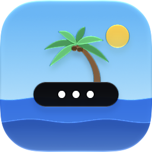
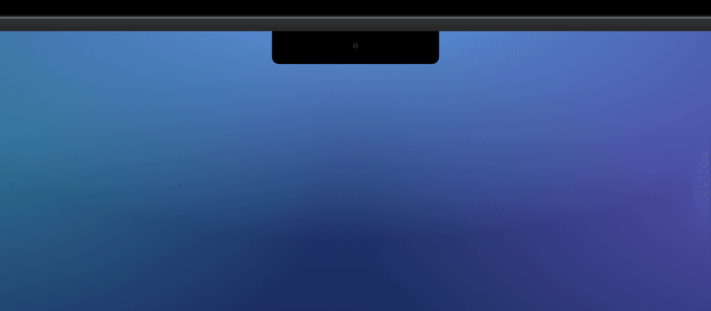

<p align="center">
  
</p>

<h1 align="center">Islander 岛民</h1>

<p align="center">
  Tuck menu bar icons into the notch. Point at the notch and they drop down in a Dynamic Island.
</p>

<p align="center">
  <b>English</b> · <a href="README.zh-CN.md">简体中文</a>
</p>

<p align="center">
  <a href="https://github.com/kadaliao/islander/releases/latest"></a>
  
  <a href="LICENSE"></a>
</p>

<p align="center">
  
</p>

---

A notched MacBook has little room for menu bar icons, and the ones that don't fit
silently disappear behind the notch. Islander hides the icons you rarely need and
shows them in an island that grows out of the notch when you point at it. Click
an icon there and its menu opens right below it.

The interface is in Simplified Chinese.

## Highlights

- **Hidden icons live in the notch.** Move the pointer onto the notch and the
  island drops down with your hidden icons; click one to open its menu in place.
- **Arrange everything in Settings.** *Menu Bar Layout* shows your real icons in
  three rows: kept in the menu bar, hidden on the island, and always hidden. Drag
  icons between rows, or right-click / double-click one. Islander moves the real
  menu bar icons for you, including ones that are off-screen or behind the notch.
- **Always hidden.** Icons you never want to see stay out of both the menu bar
  and the island. Hold ⌥ while pointing at the notch to see them anyway.
- **Matches your menu bar.** A black island on a dark menu bar, frosted glass on
  a light one, or pick one in Settings.
- **Optional Dock icon.** Click it to open Settings; right-click it to hide or
  show icons and open the island.

## Install

Download `Islander-<version>.dmg` from
[Releases](https://github.com/kadaliao/islander/releases/latest), open it, and
drag Islander into Applications. It is signed with a Developer ID and notarized.
Or install it with Homebrew:

```sh
brew install --cask kadaliao/tap/islander
```

Islander requires macOS 14 or later and is developed and tested on macOS 26.
On a Mac without a notch it draws a virtual notch in the middle of the menu bar.

### Permissions

- **Accessibility**: to tell which app each menu bar icon belongs to, open
  their menus, and move icons when you rearrange them.
- **Screen Recording**: to capture what the icons look like. Without it the
  island shows each app's icon instead. Islander only reads the menu bar.

## Build from source

Requires Xcode 26 or later and [XcodeGen](https://github.com/yonaskolb/XcodeGen).

```sh
make run       # build a Debug copy and launch it
make icon      # regenerate the app icon (Islander/App/AppIcon.icon)
make release   # signed, notarized DMG and zip in build/release (maintainers)
```

## License

[MIT](LICENSE)
