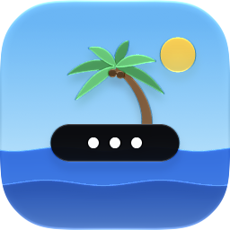
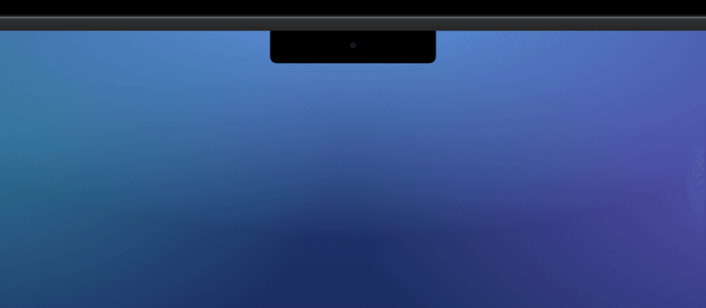

<p align="center">
  
</p>

<h1 align="center">岛民 Islander</h1>

<p align="center">
  把菜单栏图标藏进刘海，鼠标移到刘海上，它们就出现在灵动岛里。
</p>

<p align="center">
  <a href="README.md">English</a> · <b>简体中文</b>
</p>

<p align="center">
  <a href="https://github.com/kadaliao/islander/releases/latest"></a>
  
  <a href="LICENSE"></a>
</p>

<p align="center">
  
</p>

---

带刘海的 MacBook 菜单栏放不下几个图标，放不下的会悄悄躲到刘海后面。岛民把不常用的图标藏起来，
鼠标移到刘海上时，从刘海里长出一座岛来显示它们；点一下，菜单就在它正下方弹出来。

## 功能

- **藏起来的图标住在刘海里。** 鼠标移到刘海上，岛就带着藏起来的图标展开；点一下图标，菜单就地打开。
- **在设置里整理一切。** 「菜单栏布局」用你菜单栏上的真实图标排成三排：留在菜单栏、藏到岛上、永远隐藏。
  在三排之间拖动图标，或者右键 / 双击它。岛民会替你移动菜单栏上真实的图标，屏幕外、刘海后面的也行。
- **永远隐藏。** 不想看到的图标既不占菜单栏，也不出现在岛上。按住 ⌥ 再把鼠标移到刘海上，才会显示它们。
- **跟菜单栏一个颜色。** 深色菜单栏上是黑色的岛，浅色菜单栏上是毛玻璃；也可以在设置里固定一种。
- **可选的 Dock 图标。** 点它打开设置；右键可以展开灵动岛、调整菜单栏布局。

## 安装

从 [Releases](https://github.com/kadaliao/islander/releases/latest) 下载 `Islander-<版本>.dmg`，
打开后把岛民拖进「应用程序」。已用 Developer ID 签名并公证。也可以用 Homebrew 安装：

```sh
brew install --cask kadaliao/tap/islander
```

需要 macOS 14 或更新，在 macOS 26 上开发和测试。没有刘海的 Mac 上，岛民会在菜单栏正中间画一个虚拟刘海。

岛民大约每天去 GitHub 检查一次新版本，在后台下载，等你离开电脑时自己装上。可以在「设置 › 通用」里关掉。

### 权限

- **辅助功能**：识别菜单栏上每个图标属于哪个 App，替你点开它们的菜单，以及在调整布局时移动图标。
- **屏幕录制**：截取图标的样子。没有这项权限时，岛上显示对应 App 的图标。岛民只读取菜单栏。

## 从源码构建

需要 Xcode 26 或更新，以及 [XcodeGen](https://github.com/yonaskolb/XcodeGen)。

```sh
make run       # 构建调试版并启动
make icon      # 重新生成 App 图标（Islander/App/AppIcon.icon）
make release   # 签名、公证后的 DMG 和 zip，放在 build/release（维护者用）
```

## 许可证

[MIT](LICENSE)
